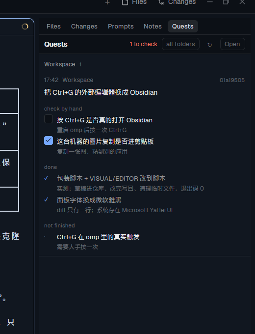

# herdr-app-mod-quests



A board of small, fixed-shape summaries of finished turns — what was asked, what got done, what a
machine proved, and what only a person can confirm. An omp extension writes them; Herdr shows them
and lets you tick each one off.

Two pieces, because only one side can do each half:

| Piece | Where | What it does |
|---|---|---|
| `omp/quests/index.ts` | `~/.omp/agent/extensions/quests/` | on `agent_end`, asks one question with `ctx.runEphemeralTurn` (same pipeline as `/btw`: current model, current conversation, no tools, nothing appended) and writes `~/.config/herdr-app/cache/quests/<session>-<time>.json` |
| `mods/quests/` | `~/.config/herdr-app/mods/quests/` | reads those files and shows the board; a tick is written back into the same file |

## Install

Ask your agent in Herdr:

```text
Read ~/.config/herdr-app/AGENTS.md, then add the mod at https://github.com/AlanWanco/herdr-app-mod-quests
```

By hand:

1. `mods/quests/` → `~/.config/herdr-app/mods/quests/`, then `herdr-app check ~/.config/herdr-app/mods/quests`.
2. `omp/quests/index.ts` → `~/.omp/agent/extensions/quests/index.ts`, and add the folder to
   `extensions:` in `~/.omp/agent/config.yml`:
   ```yaml
   extensions:
      - C:/Users/you/.omp/agent/extensions/quests
   ```
3. Restart omp (extensions load at start), then open the panel's `Quests` tab — add
   `{"id":"quests","type":"block","content":{"mod":"quests"}}` to a cloned layout's `panel-body`
   stack, or run `herdr-app do mod.open --name quests`.

## What a quest looks like

```json
{
  "session": "01a19505-…", "cwd": "E:\\Workspace", "at": "2026-11-02T09:42:13Z",
  "ask": "把 Ctrl+G 的外部编辑器换成 Obsidian",
  "done":   [{ "what": "包装脚本 + VISUAL/EDITOR 改到脚本", "proof": "实测往返成功，退出码 0", "machine": true }],
  "open":   [{ "what": "Ctrl+G 的真实触发", "why": "需要人手按一次", "needsDecision": false }],
  "verify": [{ "what": "按 Ctrl+G 是否真的打开 Obsidian", "how": "重启后按一次" }],
  "checked": { "verify:0": "2026-11-02T10:02:00Z" }
}
```

- `machine: true` only when a command output, a test or a file reading proved the item.
- `verify` is the part only a person can settle; `needsDecision` marks what needs your call.
- `checked` belongs to the board, not the extension: ticking a row writes `verify:<n>` there, so the
  state travels with the file.

## Cost and noise

The extension runs at most once per five minutes per session and only when new user messages arrived
since the last recap; it is one capped side turn (1200 tokens, no tools). Set `OMP_QUESTS=0` to turn
it off, `OMP_QUESTS_MIN_MS` to change the gap.

## Limits

- Only the end of a turn is summarised, not the start of a session.
- The board groups quests by folder, naming each group after the agent working there; two agents in
  the same folder share a group.
- The extension is plain code in your omp config; nothing enforces the schema beyond the prompt and a
  JSON parse, so a malformed answer is simply dropped.

MIT licensed.
